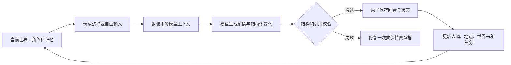

# AI 酒馆

本地优先、由玩家掌握角色控制权的 AI 互动叙事工具。

AI 酒馆把世界观、人物卡、世界书、剧情任务、原文参考和长期记忆组织成可持续演进的本地剧本。玩家可以从系统生成的候选回应中选择，也可以直接输入角色言行或长期剧情走向；模型负责扮演其他角色、评估世界变化并推进下一回合。

> 当前版本：`0.1.14`，开发预览阶段。项目没有线上服务器，游戏数据默认只保存在玩家自己的电脑中。

[AI 酒馆完整操作手册](public/使用手册/AI酒馆操作手册.md) · [导入材料标准](public/文件标准/导入材料文件结构指导手册.md) · [项目范围](docs/PROJECT_SCOPE.md) · [参与贡献](CONTRIBUTING.md) · [安全与隐私](SECURITY.md)

## 项目特点

### 互动叙事

- AI 根据世界观、人物卡、当前状态和历史事件扮演非玩家角色。
- 面对提议时可以生成“接受、部分接受、拒绝”等不同反应。
- 面对行动询问时可以生成从善意、中立到邪恶立场的候选方案。
- 玩家始终可以忽略候选项，自行输入选择、角色说话或动作。
- 独立的“剧情走向”输入可以持续影响后续发展；目标完成后会自动接续预埋任务或生成新的阶段目标。
- 最新 AI 回合不满意时，可以填写具体原因重新生成，并保留旧版本审计记录。

### 持续变化的世界

- 支持多个 AI 角色、人物自动加入或离场、地点移动与当前在场阵容同步。
- 剧情可以更新人物状态、关系、角色卡演化和动态世界书。
- 字段锁可阻止 AI 自动覆盖玩家明确保护的状态。
- 剧本任务支持前置条件、分支任务、完成条件和偏离原剧情后的续写策略。
- 长篇剧情采用近期回合、章节摘要与相关长期记忆组成的分层上下文。

### 本地存储与历史

- SQLite 本地数据库和版本化迁移。
- 单回合生成、状态变化和历史写入在同一事务内完成，失败不会留下半个回合。
- 支持历史回看、剧情分支、手动存档、自动快照与状态恢复。
- 支持单剧本完整存档导出/导入，导入时建立隔离副本，不覆盖原剧本。
- SQLite 在启动、升级和退出时自动备份，并提供整库恢复入口。

### 剧本资料

- 导入 Character Card V2/V3、常见旧人物卡和 SillyTavern 世界书 JSON。
- 上传 TXT/Markdown 原文，让模型先分析人物与开场候选，再生成可编辑剧本包草稿。
- 对生成草稿的角色、世界书、任务或开篇单独重做，比较差异后再决定是否采用。
- 现有剧本可以继续导入原文，按当前进度检索角色对话和行为参考。
- 统一剧本工作台集中编辑人物、地点、剧情任务、世界书、原文、长期记忆和修改记录。

### 模型与桌面端

- 内置 DeepSeek 与 OpenCode Go 配置。
- 支持提供 OpenAI Chat Completions 兼容协议的云端或本地模型服务。
- 可以读取模型目录、选择模型、导出不含密钥的模型清单并执行最小可用性审核。
- 提供 Apple Silicon macOS 便携桌面包，内置 Electron、Next.js 服务和本地数据库运行环境。

## 一轮剧情如何推进



模型不能替玩家补写未经允许的言行。由 AI 控制的角色、事件结果和状态变化只有通过结构、角色引用、原文证据与并发版本检查后才会写入数据库。

## 快速开始

### 环境要求

- Node.js `>=22.13.0`
- npm
- 一个支持 Chat Completions 的模型 API；使用本地兼容服务时可以不填写 API Key

### macOS 双击启动

开发阶段最简单的方式是在 Finder 中双击项目根目录的 [`启动AI酒馆.command`](启动AI酒馆.command)。启动器会检查 Node.js、安装缺少的依赖并打开浏览器。

### 终端启动

```bash
npm install
cp .env.example .env.local
npm run dev
```

浏览器访问 `http://127.0.0.1:3210`。首次进入后，从主菜单选择“API 配置”设置供应商，再选择“新剧本”或“继续游戏”。

更详细的开发与本地运行说明见 [`docs/LOCAL_RUNTIME.md`](docs/LOCAL_RUNTIME.md)。

## 模型供应商配置

推荐从主菜单进入“API 配置”完成设置。页面会显示当前供应商类型、模型、鉴权状态和接口地址，并提供以下检查：

1. 验证接口地址和 HTTPS/本机 HTTP 边界；
2. 尝试读取供应商的 `/models` 模型目录；
3. 使用所选模型发送一次最多 64 token 的最小结构化请求；
4. 检查 Chat Completions 协议、鉴权和 JSON 输出能力；
5. 审核通过后保存并立即用于后续回合。

可以在本机保存多套 API 配置（供应商、地址、模型与各自密钥），在设置面板中切换“使用”，或直接在游戏页顶栏快速切换；后续回合立即使用新选中的配置。配置与密钥保存在本机数据目录的 `api-configs.json`（0600 权限），不会进入浏览器或剧本存档；首次使用时会自动沿用旧的 `.env.local` 配置。

回合生成采用流式输出：AI 开始返回后页面实时显示正在生成的剧情；只有当结构校验通过后才会整体保存。当保存了多套 API 配置时，当前配置发生服务端错误、超时或空回复会自动切换到下一套备用配置重试一次，并在页面提示切换结果。

也可以手工建立 `.env.local`：

```dotenv
AI_PROVIDER=deepseek
AI_API_BASE_URL=https://api.deepseek.com
AI_API_KEY=
AI_MODEL=deepseek-v4-flash
AI_JSON_MODE=response_format
AI_TAVERN_DATA_DIR=./data
AI_TAVERN_BACKUP_RETENTION=12
NEXT_TELEMETRY_DISABLED=1
```

兼容服务不接受 `response_format` 时，将 `AI_JSON_MODE` 改为 `prompt_only`。不要使用 `NEXT_PUBLIC_` 前缀保存密钥，否则变量可能进入浏览器构建结果。

## 数据与隐私边界

| 内容 | 默认保存位置 | 是否发送给模型供应商 |
| --- | --- | --- |
| API Key | `.env.local`、`data/api-configs.json` 或桌面版 `用户数据/配置/模型.env` | 仅作为鉴权信息发送给玩家配置的接口，不进入浏览器和剧本存档 |
| SQLite、备份、完整存档 | `data/` 或桌面版 `用户数据/数据/` | 不整体发送 |
| 当前玩家输入 | 当前剧本数据库 | 生成下一回合时发送 |
| 角色、世界书、任务和近期剧情 | 当前剧本数据库 | 只发送本轮上下文预算选中的部分 |
| 玩家导入的原文 | 当前剧本数据库 | 分析/生成剧本包时发送限定范围；游戏回合只发送检索到的少量片段 |
| 日志与桌面缓存 | 桌面版 `用户数据/日志`、`用户数据/浏览器数据` | 不作为剧情上下文发送 |

`.env.local`、数据库、备份、测试资料、桌面构建目录和发布包都由 `.gitignore` 排除。准备公开提交前还应运行：

```bash
npm run public:check
```

该检查会读取 Git 当前跟踪列表，阻止常见密钥、私钥、SQLite、完整存档、测试资料和桌面发布物进入提交。完整说明见 [`SECURITY.md`](SECURITY.md)。

## 新建、导入与继续游戏

### 新建剧本

新建页面可以直接填写世界、玩家角色、主要 AI 角色、额外角色、开场地点和第一幕。建立世界时，程序会在一个事务中写入战役、主线分支、人物卡、基础世界书、初始状态、任务链和开场回合，完成后直接进入游戏。

### 导入人物卡和世界书

普通 JSON 导入只在本机解析和校验，不会调用模型。第一张 AI 人物卡默认作为主要角色，其余人物卡作为额外角色；完整剧本包还可以同时携带玩家人物卡、世界书、任务模块、原文和开场。

公开的格式文件和原创合成示例位于 [`public/文件标准`](public/文件标准)：

- [`剧本包标准示例.json`](public/文件标准/剧本包标准示例.json)
- [`人物卡标准示例.json`](public/文件标准/人物卡标准示例.json)
- [`世界书标准示例.json`](public/文件标准/世界书标准示例.json)
- [`导入材料文件结构指导手册.md`](public/文件标准/导入材料文件结构指导手册.md)

拆分维护目录可以通过以下命令组装和校验：

```bash
npm run bundle:check -- "你的剧本资料目录"
npm run bundle:build -- "你的剧本资料目录"
```

### 继续与迁移

“继续游戏”页面可以打开、重命名、导出或删除已有剧本，也可以导入另一台电脑导出的完整存档。完整存档包含剧情、分支、人物与地点状态、世界书、原文参考、回滚、字段锁、快照和重生成记录，但不包含模型 API Key。

## macOS 桌面版

在 Apple Silicon Mac 上构建：

```bash
npm run desktop:build:mac
```

产物位于 `发布/AI酒馆-版本-macOS-arm64/`，包括 `.app`、ZIP 和 DMG。安装时必须复制整个“AI酒馆”文件夹，保持 `AI酒馆.app` 与 `用户数据` 同级。所有运行数据都写入该文件夹，退出后删除整个文件夹即可卸载。

当前桌面包使用临时签名，只适合开发测试。公开提供安装包前仍需要 Apple Developer ID 签名、notarization、正式图标和 Intel/跨版本兼容验证。构建脚本会拒绝把开发数据库、测试资料、`.env.local` 或当前 API Key 带入安装包。

## 技术架构

| 层级 | 主要目录 | 职责 |
| --- | --- | --- |
| 网页界面 | `app/` | 主菜单与 API 配置、新建/继续游戏、游戏页和剧本工作台 |
| 本地 API | `app/api/` | 剧本、回合、分支、存档、资料编辑与模型设置接口 |
| 模型适配 | `lib/ai/` | 供应商配置、模型目录、可用性审核和兼容请求 |
| 剧情编排 | `lib/story/` | 玩家输入、提示词、结构校验、回合提交和任务推进 |
| 内容服务 | `lib/content/` | 人物、地点、任务、世界书、原文与记忆的统一命令协议 |
| 长期记忆 | `lib/memory/` | 章节摘要、事实提取、相关性召回和上下文预算 |
| 导入导出 | `lib/import/` | 人物卡、世界书、剧本包和完整存档格式 |
| 存储 | `db/`、`lib/storage/`、`drizzle/` | SQLite、迁移、事务、分支与状态物化 |
| 桌面封装 | `desktop/`、`scripts/` | Electron 窗口、无界面本地服务、macOS 打包与验证 |

## 常用命令

```bash
npm run dev                  # 开发服务器
npm run build                # Next.js 生产构建
npm run lint                 # ESLint
npm test                     # 构建并运行全部自动化测试
npm run public:check         # 检查当前提交是否混入私有数据或常见密钥
npm run public:check:history # 检查当前分支完整历史
npm run desktop:build:mac    # 生成并验证 macOS 桌面包
node scripts/发布GitHubRelease.mjs  # 发布 GitHub Release（说明见 docs/release-说明-v<版本>.md）
```

## 项目文档

| 文档 | 内容 |
| --- | --- |
| [`public/使用手册/AI酒馆操作手册.md`](public/使用手册/AI酒馆操作手册.md) | 面向玩家的完整功能和操作流程 |
| [`docs/PROJECT_SCOPE.md`](docs/PROJECT_SCOPE.md) | 产品边界、核心原则与阶段范围 |
| [`docs/GENERATION_SPEC.md`](docs/GENERATION_SPEC.md) | 模型输出、角色演化、世界书与重生成规范 |
| [`docs/FILE_LIFECYCLE.md`](docs/FILE_LIFECYCLE.md) | 内容文件生命周期与规范：玩家文件、内部记录和模型请求的数据边界 |
| [`docs/CONTENT_SERVICE.md`](docs/CONTENT_SERVICE.md) | 统一剧本内容服务规范：剧本工作台的命令与事务协议 |
| [`docs/STORAGE.md`](docs/STORAGE.md) | 数据库、事务、分支、存档、备份与记忆 |
| [`docs/IMPORT_FORMAT.md`](docs/IMPORT_FORMAT.md) | 人物卡、世界书、剧本包和完整存档格式 |
| [`docs/DEEPSEEK.md`](docs/DEEPSEEK.md) | 多供应商调用、校验、重试和上下文结构 |
| [`docs/LOCAL_RUNTIME.md`](docs/LOCAL_RUNTIME.md) | 本地开发与 macOS 桌面封装 |
| [`docs/GITHUB_PUBLICATION.md`](docs/GITHUB_PUBLICATION.md) | 不携带私有历史的 GitHub 发布流程 |
| [`docs/release-说明-v0.1.11.md`](docs/release-说明-v0.1.11.md) | GitHub Release 文案模板：每版维护一份，由发布脚本读取 |

## 当前限制与后续方向

- 当前定位是本地单机应用，不提供账号系统、在线托管或跨设备自动同步。
- macOS 桌面包目前只验证 Apple Silicon，且仍使用临时签名。
- 不同兼容模型对结构化 JSON、长上下文和内容策略的支持程度不同。
- 剧本包自动生成仍需要作者审阅人物分工、开场、世界事实和任务链。
- 桌面端自动更新、崩溃报告导出、正式发布签名和 Windows/Linux 安装包仍待建设。

## 参与贡献

提交代码前请阅读 [`CONTRIBUTING.md`](CONTRIBUTING.md)，并确保测试资料是原创或合成内容。任何 Pull Request 都不应包含真实 API Key、个人存档、日志、数据库或未获授权的原文。

## 许可证

本项目采用 [MIT License](LICENSE)。你可以使用、复制、修改、合并、发布、分发、再许可或销售本软件，但必须在软件副本或主要部分中保留原版权声明和许可声明。

Copyright (c) 2026 AI 酒馆项目
